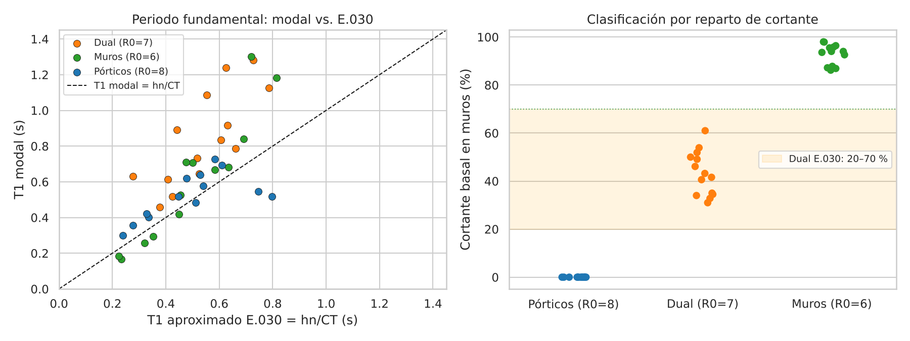
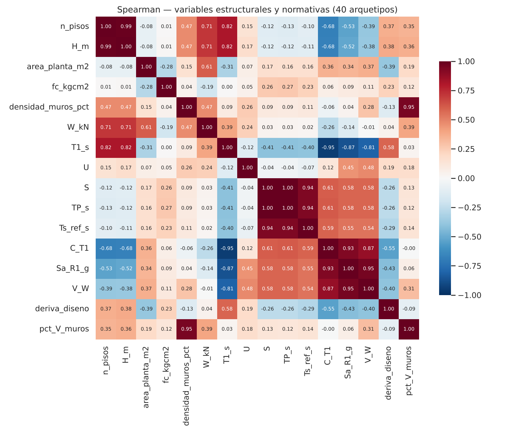
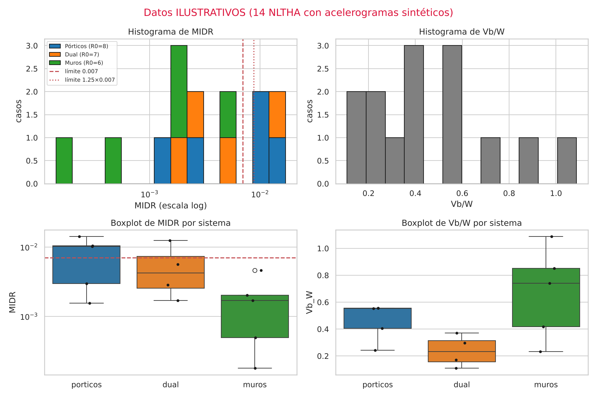
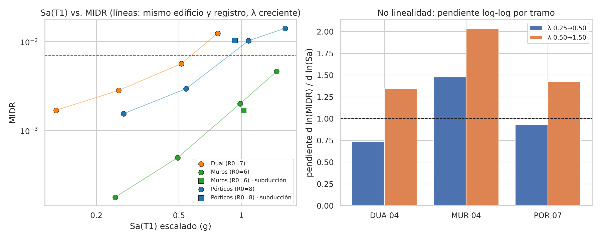
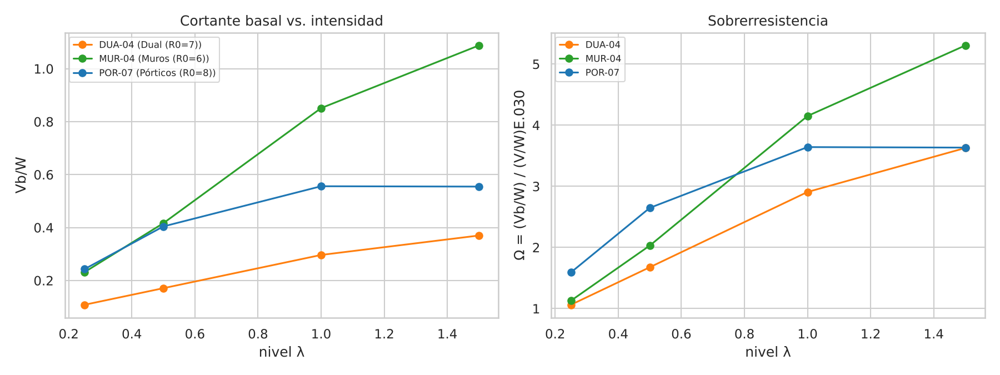

# Informe T2 — Análisis Exploratorio de Datos y Plan de Machine Learning

**Proyecto:** Predicción de Demandas Sísmicas (Deriva Máxima de Entrepiso ln(MIDR) y Cortante Basal Normalizado Vb/W) en Edificaciones de Concreto Armado en el Perú mediante Machine Learning Supervisado y la Base PEER NGA-West2 (Norma E.030-2026)

**Curso:** Aplicaciones de IA en Estructuras — UPC · **Docente:** Ing. Kurt Soncco Sinchi
**Grupo:** Paulino A. Díaz Hinostroza (e201572251) · Rodrigo A. De la Cruz Herrera (e202527672) · Guido E. Valdez Tejeira (e202528480) · Felix Mamani Huanca (e202527091) · Johnny E. Cueva Moncada (e202527071)
**Fecha:** 2 de noviembre de 2026

---

## Resumen

Se construyó y verificó la base estructural del dataset: **40 arquetipos de concreto armado** (3 a 15 pisos) diseñados con la E.030-2026. Los 40 cumplen la deriva de diseño ≤ 0.007, la regla Ts < 0.65·TP y la clasificación del sistema estructural por reparto de cortante. Se generó la matriz experimental de **16 000 NLTHA** y se probó de punta a punta el flujo flatfile → selección → NLTHA → CSV de 57 columnas → 18 controles de integridad (18/18 PASS).

El EDA del catálogo (n = 40) muestra tres cosas:

1. La fórmula $h_n/C_T$ subestima el periodo de los duales en un 44 % (mediana).
2. Ocho pares de variables son redundantes (|ρ| ≥ 0.9).
3. Z es constante en todo el dataset.

Sobre 14 NLTHA ilustrativos se verificó la no linealidad intensidad–deriva (la pendiente log-log sube de 0.93 a 1.43) y la saturación del cortante en pórticos (Ω = 3.64). El plan de ML usa validación cruzada **GroupKFold por evento sísmico**, que según la sección 3.3 evita subestimar el error en un término $\sigma_\eta^2$, más validación externa con sismos peruanos de subducción.

> **Alcance de los datos de este informe.** La campaña de 16 000 NLTHA todavía no se ha ejecutado (≈ 4 000 horas-CPU). Los hallazgos de la sección 2.1 vienen del catálogo real de 40 arquetipos. Los de la sección 2.2 vienen de **14 NLTHA reales del modelo con acelerogramas sintéticos** (`fuente = ilustrativo`): sirven para validar el flujo y anticipar el comportamiento, no son conclusiones estadísticas.

---

## 1. Planteamiento del problema estructural y justificación del dataset E.030-2026

### 1.1 Problema

La E.030 evalúa la demanda sísmica con análisis lineales. La deriva inelástica se estima como $0.75\,R\,\Delta_{el}$ (estructuras regulares) y se compara con el límite de **0.007** para concreto armado. Ese factor no responde a la duración del sismo, a la forma espectral del registro, a la concentración de daño en un piso ni a los efectos P-Δ. El análisis tiempo-historia no lineal (NLTHA) sí los captura, pero cuesta:

| Caso medido (OpenSeesPy, 1 CPU) | Registro | Tiempo |
| --- | --- | --- |
| Pórtico de 3 pisos (POR-07) | 30 s | 3–4 min |
| Dual de 6 pisos (DUA-04) | 30 s | 7–10 min |
| Muros de 5 pisos (MUR-04) | 30 s | 12–22 min |
| Muros de 5 pisos (MUR-04), registro de subducción | 80 s | ≈ 38 min |

Evaluar con NLTHA cientos de edificios, o generar curvas de fragilidad, no es viable en la práctica profesional peruana. **Un modelo sustituto de ML** entrenado con NLTHA predice la demanda no lineal en milisegundos, con un error medible.

### 1.2 Variables objetivo

$$
\mathrm{MIDR}=\max_t\max_i\max\!\left(\left|\frac{u_i^x-u_{i-1}^x}{h_i}\right|,\left|\frac{u_i^y-u_{i-1}^y}{h_i}\right|\right),
\qquad y_1=\ln(\mathrm{MIDR})
$$

$$
y_2=\frac{V_b}{W}=\frac{1}{W}\max_t\sqrt{V_{b,x}(t)^2+V_{b,y}(t)^2}
$$

Se usa ln(MIDR) porque la deriva condicionada a la intensidad es aproximadamente lognormal. En escala log, la dispersión es casi constante y el error se lee como un factor: un RMSE de 0.30 equivale a ×/÷1.35. Cada fila guarda además las marcas `cumple_0007` (MIDR ≤ 0.007) y `cumple_00875` (≤ 1.25 × 0.007, límite tiempo-historia del art. 49.2), para poder plantear también una clasificación del cumplimiento normativo.

### 1.3 Por qué un dataset propio y por qué la E.030-2026

| Decisión | Justificación |
| --- | --- |
| Edificios **diseñados con la norma peruana** | Los datasets publicados usan edificios de otros códigos; la sobrerresistencia y la rigidez dependen del diseño local |
| **E.030-2026** (RM 183-2026-VIVIENDA) | Norma vigente desde mayo de 2026: suelos por Vs30 con S, TP y TL interpolados; Ts obligatorio para categorías A y B en Z4; componentes sísmicas simultáneas; ≥ 7 pares en tiempo-historia (art. 47.1) |
| **NGA-West2** | Registros procesados de forma uniforme, con metadatos completos (Mw, Rrup, Vs30, frecuencia utilizable) |
| **Validación con subducción peruana** | NGA-West2 solo tiene sismos corticales; en Lima controla la subducción. Lima 1966, Lima 1974 y Pisco 2007 miden la transferibilidad |
| **Muestreo multinivel** λ ∈ {0.25, 0.50, 1.00, 1.50} | Cubre del rango elástico al inelástico severo; sin él, el modelo no aprende la no linealidad |

### 1.4 Composición del dataset

| Elemento | Valor |
| --- | --- |
| Arquetipos | 40: 13 pórticos (R0 = 8), 14 duales (R0 = 7), 13 muros (R0 = 6); 3–15 pisos |
| f'c | 14 × 210, 12 × 280, 14 × 350 kg/cm² |
| Categoría | 24 C (U = 1.0), 11 B (U = 1.3), 5 A2 (U = 1.5); ningún pórtico A2 (no permitido en Z4) |
| Suelo | 20 S1 (Vs30 559–799 m/s), 20 S2 (362–533 m/s); Z4, Z = 0.45 |
| Registros | 100 pares NGA-West2 (≥ 34 eventos, máx. 3 por evento) + 10 pares peruanos |
| Casos | 16 000 (entrenamiento y prueba) + 1 600 (validación externa) |
| Esquema | 57 columnas: 31 features, 2 targets, 3 marcas, 11 de control, 10 de trazabilidad |
| Integridad | 13 reglas (R1–R13) + 5 controles de dominio (D1–D5) automatizados |

**Correcciones físicas incorporadas en el diseño de los arquetipos.** Ambas se detectaron al construir el catálogo:

1. **Duales calibrados.** Con densidades de muros de 0.5–1.5 %, los "duales" tenían entre 87 % y 99 % del cortante en muros: eran sistemas de muros. Se recalibró cada dual para que los muros tomen entre 31 % y 61 % del cortante (rango E.030: 20–70 %), lo que da ρw = 0.23–0.82 %.
2. **Deformación por corte en muros.** El modelo inicial (solo flexión) daba T1 de 0.06–0.09 s en edificios de muros de 4 a 7 pisos. Se incorporó la rigidez a corte ($A_v = 5A/6$: Timoshenko en el modelo elástico, *Aggregator* en el de fibras) y se limitaron los tramos de muro a 8 m. Los periodos de muros quedaron en 0.17–1.30 s.

---

## 2. Hallazgos del Análisis Exploratorio de Datos (EDA) y comportamiento físico de las variables

Fuente: `notebooks/eda_t2.ipynb` (ejecutado). Figuras en `docs/figuras/`.

### 2.1 Catálogo de arquetipos (n = 40, datos reales)

**Estadísticas descriptivas por sistema:**

| Sistema | N | Pisos (mediana) | T1 mediana (s) | T1 IQR (s) | ρw mediana (%) | V en muros (%) | V/W diseño (mediana) | Deriva de diseño máx. |
| --- | --- | --- | --- | --- | --- | --- | --- | --- |
| Pórticos | 13 | 6 | 0.519 | 0.198 | 0 | 0 | 0.133 | 0.0068 |
| Dual | 14 | 10.5 | 0.811 | 0.410 | 0.42 | 31 – 61 | 0.106 | 0.0070 |
| Muros | 13 | 10 | 0.669 | 0.415 | 1.99 | 86 – 98 | 0.181 | 0.0070 |

Rango global: T1 = 0.168–1.301 s; W = 8.0–109.6 MN; Sa(T1) con R = 1 = 0.346–1.768 g; V/W de diseño = 0.050–0.295.



**H1 — La fórmula $h_n/C_T$ subestima el periodo de los duales.** Cociente T1 modal / T1 E.030 (mínimo · mediana · máximo):

| Sistema | Mín. | Mediana | Máx. |
| --- | --- | --- | --- |
| Pórticos | 0.65 | 1.19 | 1.30 |
| Dual | 1.19 | **1.44** | 2.27 |
| Muros | 0.72 | 1.15 | 1.81 |

La E.030 asigna a los duales el mismo $C_T = 60$ que a los muros, aunque en estos arquetipos los pórticos aportan entre 39 % y 69 % de la rigidez. **Consecuencia para el dataset:** el escalamiento y la feature `T1_s` usan el periodo modal, no el de la fórmula.

**H2 — La clasificación del sistema es correcta en los 40 arquetipos.** Pórticos 0 %, duales 31–61 %, muros 86–98 % del cortante en muros. Las tres poblaciones están separadas, sin casos ambiguos cerca de los umbrales de 20 % y 70 %.

**H3 — Redundancias entre variables (Spearman, |ρ| ≥ 0.9):**



| Par | ρ | Explicación física | Tratamiento propuesto |
| --- | --- | --- | --- |
| `n_pisos` – `H_m` | 0.99 | H = n · h, con h en un rango estrecho | Conservar una sola en los modelos lineales |
| `S` – `TP_s` | 1.00 | En S2 ambas se interpolan con el mismo Vs30 | Una sola, o reemplazarlas por Vs30 del sitio |
| `S`/`TP_s` – `Ts_s` | 0.94 | Ts de referencia = 120/Vs30 | Ts es redundante (docs/03) |
| `T1_s` – `C_T1` | −0.95 | C = 2.5·TP/T en la rama descendente | Interpretar juntas en SHAP |
| `C_T1` – `Sa_dis_R1_g` | 0.93 | Sa = Z·U·C·S | Ídem |
| `Sa_dis_R1_g` – `Vest_W` | 0.95 | V/W = Sa/R | Ídem |
| `densidad_muros_pct` – % V en muros | 0.95 | La densidad controla el reparto | Esperado |
| `R0` – `sistema` | 1 a 1 | Por definición | Usar solo `sistema` |

Además, **Z = 0.45 es constante** en todo el dataset (todos en Z4): no aporta información y se excluye de los modelos.

### 2.2 Respuesta NLTHA (n = 14, ilustrativo)

Tres arquetipos (POR-07, DUA-04, MUR-04) × 1 acelerograma sintético cortical × 4 niveles, más 2 casos con un acelerograma sintético de tipo subducción. Todos convergieron, sin colapsos.

**Descriptivos:** MIDR = 0.0002–0.0141 (mediana 0.0029, IQR 0.0074); ln(MIDR) = −8.64 a −4.26; Vb/W = 0.108–1.088 (mediana 0.410).



**Cumplimiento por nivel:** a λ = 0.25 y 0.50 cumple el 100 % de los casos; a λ = 1.00, el 60 %; a λ = 1.50, el 33 %. Con un solo registro por arquetipo esto no juzga el diseño (la E.030 exige el promedio de ≥ 7 pares), pero confirma que las clases "cumple / no cumple" quedarán pobladas en los niveles altos.

**H4 — La relación intensidad–deriva es no lineal.**



| Arquetipo | Pendiente d ln MIDR / d ln Sa, λ 0.25→0.50 | λ 0.50→1.50 |
| --- | --- | --- |
| DUA-04 | 0.74 | 1.35 |
| MUR-04 | 1.48 | 2.03 |
| POR-07 | 0.93 | 1.43 |
| **Mediana** | **0.93** | **1.43** |

En el tramo bajo la pendiente es ≈ 1 (respuesta casi proporcional, regla de igual desplazamiento). En el tramo alto sube a 1.4–2.0 por la fluencia. En el muro, la pendiente > 1 desde el primer tramo se atribuye a la fisuración del concreto en el modelo de fibras (hipótesis a verificar con más casos). **Implicancia:** un modelo log-lineal con pendiente única no basta; se justifican modelos no lineales (árboles, redes) o interacciones explícitas.

**H5 — El cortante del pórtico se satura: sobrerresistencia Ω ≈ 3.6.**



| Arquetipo | Ω (λ = 0.25) | Ω (0.50) | Ω (1.00) | Ω (1.50) | Cambio de Vb de λ 1.0 a 1.5 |
| --- | --- | --- | --- | --- | --- |
| POR-07 | 1.59 | 2.65 | **3.64** | **3.63** | **−0.2 %** (saturado) |
| DUA-04 | 1.06 | 1.68 | 2.91 | 3.63 | +24.7 % |
| MUR-04 | 1.13 | 2.03 | 4.15 | 5.30 | +27.8 % (casi elástico) |

Con $\Omega = (V_b/W)_{NLTHA}/(V/W)_{E.030}$, el pórtico alcanzó su mecanismo: más intensidad ya no aumenta el cortante, solo la deriva. El edificio de muros (T1 = 0.17 s) sigue cargándose casi elásticamente. **Implicancia:** Vb/W tiene un techo que depende del sistema; los modelos deben poder representar esa saturación (los árboles lo hacen de forma natural; un modelo lineal no).

**H6 — Correlaciones con los targets** (Spearman, n = 14; Z y U constantes en esta muestra):

| Feature | ρ con ln(MIDR) | ρ con Vb/W |
| --- | --- | --- |
| `Sa_T1_g` | 0.61 | 0.90 |
| `ASI_gs` | 0.58 | 0.84 |
| `PGA_g` | 0.56 | 0.83 |
| `HI_m` | 0.56 | 0.85 |
| `densidad_muros_pct` | −0.55 | 0.19 |

Las medidas de intensidad dominan, como se esperaba. Para la deriva, la densidad de muros aparece con signo negativo (más muros, menos deriva), coherente con la física.

**H7 — Duración (subducción vs. cortical).** Para POR-07 a λ = 1.0, el registro de tipo subducción tuvo una Sa_avg similar (0.866 vs. 0.843 g), triplicó la duración (D5-95 = 37.9 vs. 12.6 s) y multiplicó por 3.6 la energía de Arias, con una deriva casi igual (0.0104 vs. 0.0102). Si este patrón se confirma, la duración afectaría más la degradación y el colapso que la deriva máxima. Es la hipótesis principal que medirá la validación externa.

**H8 — Factores de escala fuera de rango.** El registro sintético de subducción (PGA 0.09 g) llevado al espectro de MUR-04 requirió sf = 6.14 > 5 y quedó marcado con `flag_sf_rango = 0`. Ocurrirá también con los registros reales de Lima de Pisco 2007 (PGA 0.06–0.12 g).

---

## 3. Plan algorítmico y estrategia de validación cruzada GroupKFold

### 3.1 Formulación

Para cada caso $k$ (arquetipo $b$, registro $r$ del evento $e$, nivel λ), con $\mathbf{x}_k \in \mathbb{R}^{31}$ y $y_k \in \{\ln \mathrm{MIDR},\ V_b/W\}$:

$$
\hat\theta=\arg\min_\theta\ \frac{1}{N}\sum_{k=1}^{N}\big(y_k-\hat g_\theta(\mathbf{x}_k)\big)^2+\Omega(\theta)
$$

Filas usadas: `convergencia = 1`. Para Vb/W, además, `colapso = 0`. Se informa por separado el efecto de excluir los casos con `flag_sf_rango = 0`.

### 3.2 Modelos a comparar

| Modelo | Por qué | Preprocesamiento |
| --- | --- | --- |
| Ridge log-lineal (línea base) | Reproduce el modelo clásico de demanda $\ln \mathrm{MIDR} = a + b\ln S_a + \dots$; si un modelo complejo no le gana, la complejidad no se justifica | ln en variables de escala + estandarización |
| Random Forest | No linealidad e interacciones; robusto | ln (los árboles son invariantes a transformaciones monótonas, pero se mantiene por coherencia) |
| XGBoost | Gradient boosting, estado del arte en datos tabulares | ídem |
| LightGBM | Boosting rápido para 16 000 filas × 31 variables | ídem |
| Red neuronal MLP (PyTorch) | Aproximador universal suave; contraste con los árboles | ln + estandarización (entrada y salida) |

**Variantes de features** (prueba de estabilidad): (a) las 31 completas; (b) reducida, sin Z, R0, H_m, TP_s, Ts_s ni `factor_escala` (redundantes o de diseño experimental, sección 2.1).

**Ajuste de hiperparámetros:** búsqueda aleatoria (30 combinaciones por modelo) **dentro** de cada fold de entrenamiento, con GroupKFold interno (validación cruzada anidada).

### 3.3 Por qué GroupKFold por evento evita la fuga de información

**Modelo de efectos mixtos de la demanda.** Para el caso $k$ del evento $e$:

$$
y_{k}=f(\mathbf{x}_{k})+\eta_{e}+\varepsilon_{k},\qquad
\eta_e\sim\mathcal{N}(0,\sigma_\eta^2),\quad \varepsilon_k\sim\mathcal{N}(0,\sigma_\varepsilon^2)
$$

$\eta_e$ es el **efecto del evento**: todo lo que el sismo tiene en común y las features no describen por completo (forma espectral fina, contenido de pulsos residuales, patrón de fase). Lo comparten **todas** las filas del evento: hasta 3 registros × 40 arquetipos × 4 niveles = **480 filas**.

**Error que se quiere estimar.** Al usar el modelo en un sismo nuevo $e^*$, $\eta_{e^*}$ es desconocido e independiente del entrenamiento:

$$
\mathbb{E}\big[(y-\hat g(\mathbf{x}))^2\big]_{\text{sismo nuevo}}=\underbrace{\mathbb{E}\big[(f-\hat g)^2\big]}_{\text{sesgo}+\text{varianza}}+\sigma_\eta^2+\sigma_\varepsilon^2
$$

**K-Fold aleatorio.** Con K = 5 folds y $n_e = 480$ filas por evento, la probabilidad de que **ninguna** fila del evento caiga en entrenamiento cuando una de ellas se valida es $(1/K)^{n_e-1} = 0.2^{479} \approx 0$. Casi todas las filas de validación tienen "hermanas" del mismo evento en entrenamiento. Como Mw, Rrup, Vs30 y D5-95 son idénticos en todas las filas del evento, funcionan como una **huella** que un modelo flexible (árbol, red) usa para aprender $\hat\eta_e \approx \eta_e$. Entonces:

$$
\mathbb{E}\big[\widehat{\mathrm{MSE}}_{\text{KFold}}\big]\approx \mathbb{E}\big[(f-\hat g)^2\big]+\sigma_\varepsilon^2 \ \ <\ \ \text{error real en sismos nuevos}
$$

El K-Fold aleatorio **subestima el error exactamente en el término** $\sigma_\eta^2$, y sobreestima el $R^2$.

**GroupKFold por evento.** Los folds se forman con eventos completos: $\{e : k\in\text{val}\}\cap\{e : k\in\text{train}\}=\varnothing$. El modelo no puede conocer $\eta_e$ de un evento que nunca vio:

$$
\mathbb{E}\big[\widehat{\mathrm{MSE}}_{\text{GroupKFold}}\big]\approx \mathbb{E}\big[(f-\hat g)^2\big]+\sigma_\eta^2+\sigma_\varepsilon^2
$$

Es un estimador **insesgado** del error en sismos nuevos, que es el uso real del modelo.

**Verificación numérica** (prueba previa del proyecto con un dataset sintético de 6 000 casos construido con $\sigma_\eta = 0.25$ y $\sigma_\varepsilon = 0.18$, modelo LightGBM):

| Esquema | RMSE teórico | RMSE observado | $R^2$ observado |
| --- | --- | --- | --- |
| K-Fold aleatorio | $\sigma_\varepsilon \approx 0.18$ | 0.198 | 0.941 |
| GroupKFold por evento | $\sqrt{\sigma_\eta^2+\sigma_\varepsilon^2} \approx 0.31$ | 0.290 | 0.874 |

El K-Fold aleatorio reportó un error 32 % menor que el real, de la magnitud que predice la teoría.

### 3.4 Esquema de validación

```text
16 000 casos NGA-West2
├── Prueba retenida: 20 % de los EVENTOS (fijada en registros_seleccionados.csv,
│                    columna particion, semilla 2026) → métricas finales TEST_*
└── Entrenamiento: 80 % de los eventos
    └── GroupKFold(5) por eqid → selección de modelo e hiperparámetros (CV_*)

1 600 casos peruanos (valid_ext) → nunca se usan para ajustar nada
```

### 3.5 Métricas

| Target | Métricas |
| --- | --- |
| ln(MIDR) | $R^2$, RMSE (≈ $\sigma_{\ln}$), MAPE sobre MIDR en escala física |
| Vb/W | $R^2$, RMSE, MAPE |
| Cumplimiento (derivado de la predicción de MIDR) | Matriz de confusión, precisión, **recall de la clase "no cumple"** (la métrica de seguridad: un falso "cumple" es inseguro), F1; con los umbrales 0.007 y 0.00875 |

**Criterios de aceptación** (fijados antes de ver resultados): $R^2_{test}$(ln MIDR) ≥ 0.85; $\sigma_{\ln}$ ≤ 0.35; F1 de "no cumple" ≥ 0.85; brecha CV–prueba ≤ 0.05 en $R^2$; el mejor modelo debe superar a la línea base Ridge.

---

## 4. Cumplimiento del marco VDS / PCS

Veridical Data Science (Yu y Kumbier, 2020; Yu y Barter, 2024) exige que un resultado sea **P**redecible, **C**omputable y **E**stable (*Stability*) para considerarlo confiable.

### 4.1 Predictibilidad

| Mecanismo | Implementación |
| --- | --- |
| Error en sismos nuevos | GroupKFold por evento + prueba retenida por evento (sección 3) |
| Línea base física | Ridge log-lineal como referencia mínima |
| Generalización fuera de dominio | Validación externa con subducción peruana (Lima 1966, Lima 1974, Pisco 2007), nunca usada en el ajuste |
| Chequeo de dominio | Percentil de cada IM peruana dentro de la distribución de entrenamiento; fuera de [2.5, 97.5] se reporta como extrapolación |

### 4.2 Computabilidad (reproducibilidad en GitHub)

| Elemento | Estado |
| --- | --- |
| Código versionado | `src/` (9 módulos), notebook ejecutado con salidas, figuras |
| Semillas fijas | Catálogo (LHS, 2026), selección y partición de registros (2026), modelos |
| Dependencias | `requirements.txt` |
| Integridad automática | `validar_integridad.py`: 13 reglas + 5 controles; `--estricto` devuelve código 1 si algo falla; prueba negativa en `tests/` |
| Trazabilidad por fila | `id_caso`, `fuente`, `version_e030`, `t_cpu_s`; campaña reanudable caso por caso; errores en `_errores.csv` |
| Datos crudos | No se versionan (tamaño y condiciones de uso de PEER, CISMID e IGP); se documenta cómo obtenerlos (docs/02) |

### 4.3 Estabilidad

Una conclusión se acepta solo si sobrevive a estas perturbaciones razonables:

| Perturbación | Cómo se aplica | Qué debe mantenerse |
| --- | --- | --- |
| **Vs30 del sitio** | (a) Entrenar con arquetipos S1 y probar en S2, y viceversa; (b) comparar el desempeño por estrato de Vs30 | $R^2$ y $\sigma_{\ln}$ sin caídas mayores a 0.05 / 0.05; ranking de importancia SHAP estable |
| **Vs30 de la estación** | Error por tercio del rango de Vs30 de la estación (350–500, 500–650, 650–800 m/s) | Sin sesgo sistemático de los residuos |
| **Tipo de fuente (subducción)** | Validación externa; residuos frente a D5-95 | Cuantificar el sesgo; si la pendiente de los residuos vs. ln D5-95 es significativa, reportar la limitación y proponer entrenamiento mixto con NGA-Sub |
| Semillas y partición de eventos | 5 repeticiones con distinta semilla y partición | Desviación estándar de $R^2$ ≤ 0.02 |
| Muestra de edificios | Bootstrap de los 40 arquetipos | Ídem |
| Algoritmo | Cinco familias de modelos | Las conclusiones físicas (signos y ranking SHAP) coinciden entre modelos |
| Modelado estructural | Submuestra con rótulas IMK en vigas en lugar de fibras | Diferencia de MIDR mediana reportada |
| Selección de features | Conjuntos completo y reducido | Desempeño equivalente (± 0.02 en $R^2$) |

### 4.4 Riesgos y pendientes

| Riesgo | Mitigación |
| --- | --- |
| Tablas 4 y 5 de la E.030-2026 transcritas de un PDF con ruido | Contrastar con el PDF oficial antes de la T3 |
| Diseño por rigidez, no por resistencia E.060 | Validar en ETABS de 4 a 6 arquetipos (periodo y deriva) |
| Costo de cómputo (≈ 4 000 h-CPU) | Piloto de 320 casos; si no hay cómputo suficiente, escenario reducido 40 × 50 × 3 = 6 000 casos |
| Vs30 de las estaciones peruanas desconocido | Completar con estudios de microzonificación de CISMID |

---

## Referencias

1. Ministerio de Vivienda, Construcción y Saneamiento (2026). *RM N° 183-2026-VIVIENDA: modificación de la Norma Técnica E.030 Diseño Sismorresistente*. El Peruano, 3 de mayo de 2026.
2. Ancheta, T. D., et al. (2014). NGA-West2 database. *Earthquake Spectra*, 30(3), 989–1005.
3. Cornell, C. A., Jalayer, F., Hamburger, R. O., y Foutch, D. A. (2002). Probabilistic basis for 2000 SAC/FEMA steel moment frame guidelines. *Journal of Structural Engineering*, 128(4), 526–533.
4. Yu, B., y Kumbier, K. (2020). Veridical data science. *PNAS*, 117(8), 3920–3929.
5. Roberts, D. R., et al. (2017). Cross-validation strategies for data with temporal, spatial, hierarchical, or phylogenetic structure. *Ecography*, 40(8), 913–929.
6. Haselton, C. B., Liel, A. B., Taylor-Lange, S. C., y Deierlein, G. G. (2016). Calibration of model to simulate response of reinforced concrete beam-columns to collapse. *ACI Structural Journal*, 113(6).
7. Kaveh, A., Ilchi Ghazaan, M., y Mohammadi, A. (2026). Seismic response prediction of 3D reinforcement concrete frames using machine learning methods. *Periodica Polytechnica Civil Engineering*, 70(1).
8. Beck, S. L., y Nishenko, S. P. (1990). Variations in the mode of great earthquake rupture along the Central Peru Subduction Zone. *Geophysical Research Letters*, 17(11).
9. Yu, B., y Barter, R. (2024). *Veridical Data Science*. MIT Press. https://vdsbook.com/
